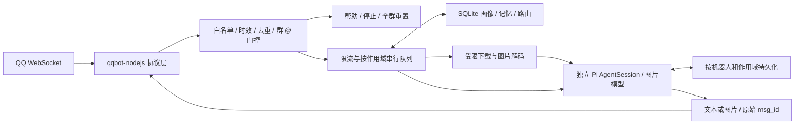

# 技术路线：Pi 的 QQ 私聊与群聊适配

决策：使用 **TypeScript + qqbot-nodejs + Pi SDK**。共享一个服务核心，提供独立 CLI 和 Pi 扩展两个入口。已实现文本、按作用域持久化的画像与记忆，以及可选图片理解和生成；后续按实际平台权限接入扫码绑定、C2C 流式与语音。

## 三个仓库的定位

| 项目与审阅版本 | 能力与集成代价 | 决策 |
|---|---|---|
| `qqbot-agent-sdk` 1.2.2，`6163b5d` | 独立 Python SDK，提供 Gateway、OpenAPI、媒体、扫码与审批能力；本身不依赖 Agent 框架。接入 TypeScript Pi 需要额外 Python 进程、IPC、部署与生命周期管理。 | Python Agent 可优先考虑；本项目不引入这层运行时。 |
| `qqbot-nodejs` 1.0.5，`429a0f1` | TypeScript QQBot facade，覆盖 C2C/群聊、Token、WebSocket、媒体、流式及中间件；与 Pi 同语言、同进程。 | 用作 QQ 协议层，锁定版本。 |
| `openclaw-qqbot` 2.0.4，`8998881` | 基于 Node SDK 和 connector 的完整 OpenClaw 通道插件，包含群策略、路由、流式、配置与工具集成。 | 参考交互设计和平台适配经验；Pi 会话与生命周期自行实现。 |

源码依据：[Python README](https://github.com/tencent-connect/qqbot-agent-sdk/blob/6163b5dc979a2f12379b1916805009075008c3c3/README.md)、[Node QQBot](https://github.com/tencent-connect/qqbot-nodejs/blob/429a0f1b798f3b0fcef3679e207dbc0469a1df2d/src/QQBot.ts)、[OpenClaw package.json](https://github.com/tencent-connect/openclaw-qqbot/blob/89988812442583bf47c34b89f9abf5fd4b85df0b/package.json)。三个仓库均使用 MIT 许可。本项目使用 SDK 依赖并参考设计，没有搬入 OpenClaw 的实现层。

## Pi 接入方式

适配目标为 `@earendil-works/pi-coding-agent@1.4.0`，Node 要求为 `>=22.19.0`。开发依赖固定 1.4.0，宿主 peer 范围为 `~1.4.0`。本项目使用 `@earendil-works` 维护分支，旧包名 `@mariozechner/pi-coding-agent` 的示例不能直接套用。

从初版的 1.2.0 升级后，所用的 ModelRuntime、资源加载器、会话创建和扩展注册接口保持兼容。1.3/1.4 调整了恢复会话时的工具加载行为，因此继续显式设置空工具列表和 `noTools: "all"`，并通过带有历史 read/bash 声明的真实 SDK 集成测试验证它们不会重新启用。上游已将内部 Pi 依赖固定为同一发布版本，本项目锁文件也统一到 1.4.0。此适配不修改宿主 Pi 安装。

使用 `ModelRuntime.create`、`createAgentSession` 和 `SessionManager.continueRecent`。每次请求加载对应聊天的持久会话，完成后释放 AgentSession；同一聊天由队列保证串行。扩展默认跟随宿主当前模型，并通过宿主 ModelRegistry 处理请求与认证；独立 CLI 读取本机模型配置、认证及保存的默认模型。两种入口都显式传入空资源加载器与 `tools: []`、`noTools: "all"`，从源头阻止聊天进程发现本机扩展和工作区上下文。

Pi 的终端主会话不承载 QQ 消息。否则群聊可能读取终端上下文，多个聊天也会互相覆盖。会话键采用 `JSON.stringify([appId, scope, targetId])`，成员隔离模式使用 `[appId, "group-member", groupId, senderId]`，在磁盘上哈希成目录名。群模式变化或全群重置增加持久化 epoch；普通重置通过原子切换会话代次实现，均保留原历史。长期记忆使用不含 epoch 的独立作用域，重置不丢失记忆。

Pi 的 `prompt()` 返回后仍需检查最终 assistant 消息：模型错误可能表现为 `stopReason: error`，而不是 Promise rejection。取消会等待 `session.abort()` 完成，之后才 `dispose()` 并允许队列继续。

扩展为每次开始处理的请求取得宿主模型快照，通过一个仅存在内存中的 provider 将独立 AgentSession 的请求转交宿主 `ModelRegistry.streamSimple`。该 provider 不保存密钥，不读取另一份模型配置；OAuth 刷新、运行时凭据和自定义 provider 均由宿主处理。局部模型使用内部 transport API 标识，避免在独立 runtime 中重复路由宿主虚拟模型；虚拟路由采用宿主的 direct 请求语义，不共享终端的路由状态。旧对话恢复后仍显式选择本次模型，避免历史模型覆盖宿主当前选择。显式配置 `model` 时固定使用指定模型。

## 数据与控制流程

CLI 和扩展共用 `QQService`。扩展仅在 `/qq start` 时启动，`QQBot.start()` 的长期 Promise 保存在服务内部，不阻塞扩展注册。停止时取消网关和模型任务，等待退出，再释放进程锁。库中不安装全局退出处理器、不调用 `process.exit()`；只有 CLI 监听 SIGINT/SIGTERM。

## 记忆与媒体实现

记忆使用 Node 内置 SQLite，启用 WAL、`secure_delete` 和删除后的 checkpoint。条目按机器人、聊天类型、群及成员隔离；画像、明确记忆与待确认候选统一管理。检索按画像、关键词和时间排序，并限制条数与正文长度；没有跨身份关联或向量检索。模型输入中的记忆是用户数据，不提升为系统权限。

所有记忆修改与模型请求通过同一作用域队列串行执行。`/forget` 先删除该作用域索引记录的所有 Pi 会话目录与内存缓存，再删除条目，防止旧上下文重新带入已删除事实。修改画像或停用记忆也清理历史；自动提取只创建有效期 7 天的候选，确认后才参与检索。SQLite 的路由 epoch 防止群模式切回时重新打开旧会话。

图片下载只接受事件附件的公共 HTTPS 地址，不跟随重定向；实际 socket DNS lookup 校验全部地址，限制输入字节和解码像素。Sharp 将静态 PNG/JPEG/WebP 统一成去元数据的 JPEG。图片理解使用 `session.prompt(..., { images })`，图片生成使用 Pi 1.4 的 `ModelRuntime.generateImages`，后者单独选择 image 类型模型。发送调用 QQ SDK `sendImage`，检查返回的消息 ID，不将仅上传成功视为已发出消息。

图片的原始下载字节不落盘，但归一化后的视觉输入会随 Pi 会话保存。生成请求独立于聊天历史；没有让聊天模型自由下载链接或调用本机文件工具。Sharp 及其 libvips 原生依赖各自的许可证说明见 [第三方声明](../THIRD_PARTY_NOTICES.md)。

## 源码审阅带来的修正

1. **流式发送成功需要单独确认。** [OpenClaw StreamingController](https://github.com/tencent-connect/openclaw-qqbot/blob/89988812442583bf47c34b89f9abf5fd4b85df0b/src/outbound/streaming-controller.ts) 在 `await session.update()` 后递增 `sentChunkCount`；但 [Node StreamSession](https://github.com/tencent-connect/qqbot-nodejs/blob/429a0f1b798f3b0fcef3679e207dbc0469a1df2d/src/streaming.ts) 的 update 可能只是进入节流缓冲，后台发送错误也不一定在此调用上抛出。这个计数不能作为网络发送确认，不能据此安全决定静态补发。初版统一最终文本，下一阶段为 C2C 设计明确的发送状态和失败策略。
2. **超时不能直接释放会话锁。** [SDK concurrencyGuard](https://github.com/tencent-connect/qqbot-nodejs/blob/429a0f1b798f3b0fcef3679e207dbc0469a1df2d/src/middleware/concurrency-guard.ts) 的超时释放不保证底层任务结束。Pi 持久会话需要独占写入，因此使用自己的队列，abort 后一直持锁到任务 settle。
3. **默认中间件不等于业务策略。** [rateLimiter](https://github.com/tencent-connect/qqbot-nodejs/blob/429a0f1b798f3b0fcef3679e207dbc0469a1df2d/src/middleware/rate-limiter.ts) 无参数时未启用限额；[messageFilter](https://github.com/tencent-connect/qqbot-nodejs/blob/429a0f1b798f3b0fcef3679e207dbc0469a1df2d/src/middleware/message-filter.ts) 的重复检查与过期清理顺序也不能直接满足真实 TTL 语义。本项目实现明确预算与 TTL，控制命令不占模型限额。
4. **错误捕获必须覆盖真正的执行入口。** QQBot 的 message 事件处理器错误由 emit 内部捕获；外围中间件无法据此判断代理请求是否失败。本项目在终端中间件直接调用桥接器并捕获异常；面向用户的错误由桥接器统一转换，不泄露模型或 QQ HTTP 响应体。
5. **历史消费以快照为单位。** 清空整个群缓冲可能删除模型处理期间新到达的消息。只消费本次取用的消息 ID，后到消息留给下一次触发。会话恢复、待用群历史和平台引用三者互不混用。
6. **群全量消息是平台权限问题。** `requireMention: false` 只改变已收到消息的策略。不能宣称关闭门控即可读取全群消息；平台不推送的消息无法保存或补齐。
7. **管理员身份必须绑定作用域。** C2C `user_openid` 和群 `member_openid` 不是通用用户 ID；群管理员按每个群分别配置，不能从私聊白名单自动推导。
8. **群 @ 标记有两种输入。** 既处理 `mentions[].is_you`，也按确切 AppID 去除文本 `<@AppID>`/`<@!AppID>`，避免缺失结构化 mentions 时 `/stop` 被当成普通文本。保留对其他人的 @。

## 已实现与后续顺序

已实现：文本私聊/群聊、显式白名单、默认 @、有界群上下文、聊天隔离、持久 Pi 会话、去重、队列、模型限流、取消/超时、管理员重置、实例锁、WebSocket Resume 状态持久化、CLI 与扩展入口。0.2.0 新增群成员隔离、SQLite 画像与长期记忆、可确认的自动提取，以及图片理解、回传和生成。

后续优先级：

1. **真实平台联调。** 验证 C2C 与群事件、OpenID 获取、@ 文本、附件 URL/下载策略、媒体上传与回复额度/时限、长消息和断线恢复；使用独立测试机器人及测试群。
2. **扫码与配对。** 按 OpenClaw 的分层方式使用 `@tencent-connect/qqbot-connector`，先明确密钥的受限文件存储或系统凭据存储，再加入登录入口。当前没有安装这项未使用的依赖。
3. **C2C 原生流式。** 只在发送确认、节流 flush、终态确认和超时行为可验证后启用；群继续按能力使用最终回复。避免“已部分发送又全量补发”的重复答案。
4. **更多媒体与记忆检索。** 在图片实机联调后评估语音；记忆数据量增大时再引入向量检索。跨场景身份关联需要用户明确绑定及可撤销的权限设计。
5. **可选工具。** 单独定义授权和作用域，不把个人编程会话的默认文件/shell 权限直接暴露给群成员。

当前测试覆盖本地行为，并使用真实 Pi SDK 对本地模拟模型执行多轮请求；不构成 QQ 线上权限、额度或 SDK 全部故障路径已验证的证明。重启去重、发送确认、跨主机单实例及磁盘保留期限仍是后续可靠性工作。
